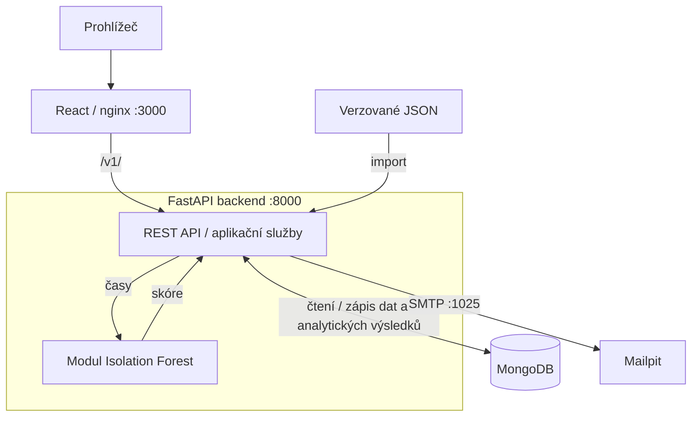

[EN](README.md) · **CZ**

# Flamma

Analytická aplikace propojující zpracování historických výsledků požárního sportu, sjednocování identit závodníků a detekci neobvyklých výkonů pomocí strojového učení.

[](https://github.com/adelaleppeltova/firesport-app/actions/workflows/ci.yml)

## Přehled

Historické výsledky požárního sportu jsou rozptýlené ve výsledkových listinách s nekonzistentními jmény a neúplnými identifikačními údaji. Flamma je propojuje do prohledávatelné historie disciplíny **běh na 100 m s překážkami** a spojuje zpracování dat, sjednocování identit závodníků, REST API, uložení v MongoDB, interaktivní vizualizace a strojové učení.

Flamma vznikla jako praktická část mé diplomové práce. Navrhla jsem datový model a vytvořila aplikaci i analytický postup, který propojuje zdrojové JSON záznamy s historií závodníků a uloženými skóre anomálií.


## Hlavní funkce a ukázky aplikace

- Vyhledávání, řazení a stránkování závodníků i soutěží, výsledkové tabulky kategorií a historie závodníka.
- Registrace, přihlášení, obnova hesla a spárování účtu se závodníkem; osobní souhrny sezony, trendu a stability.
- Import JSON, kontrola nejistých shod, ruční přiřazení a slučování duplicitních závodníků.
- Prohlížení neobvyklých výkonů podle závodníka, skupiny kategorií a překrývajících se tříletých období.

<details>
<summary>Historie závodníka</summary>


</details>

<details open>
<summary>Neobvyklé výkony</summary>


</details>

<details>
<summary>Administrace importu</summary>


</details>

[Úplná galerie včetně mobilního rozložení](docs/screenshots/README.md). Rozhraní aplikace je v češtině.

## Technicky zajímavá řešení

| Problém | Implementované řešení a zdroj |
| --- | --- |
| Neúplné a nekonzistentní identity | [Párovací služba](backend/app/services/result_matching.py) kombinuje normalizované jméno, rok narození, tým a FS kód; nejednoznačné kandidáty ponechává ke kontrole. Jednoznačná shoda jména a roku umožní spojení i při změně týmu. |
| Zachování identity a kontrola duplicit | [Importer](backend/app/services/data_import.py) hledá duplicitní výsledky a ukládá `imported_athlete`, `match_status` a `match_reason` vedle odkazu na sjednoceného závodníka. [Slučovací služba](backend/app/services/athlete_merge.py) sjednocuje identity a související odkazy. |
| Různé významy neobvyklého výsledku | [Deterministická pravidla kvality](backend/app/services/quality_flag_service.py) označují podezřelé hodnoty nezávisle na [Isolation Forest](backend/app/ml/isolation_forest.py). API zpřístupňuje oba signály. |
| Dohledatelné analytické výstupy | [Služba časových oken](backend/app/services/anomaly_service.py) ukládá parametry běhu, důvody vynechání a skóre výsledků; přepočet nahrazuje předchozí běhy. |
| Propojení prohlížeče a API | [nginx](frontend/nginx.conf) poskytuje React build a předává `/v1/` FastAPI; typované odpovědi a databázové indexy podporují aplikační dotazy. |

## Technologie a architektura

| Vrstva | Technologie |
| --- | --- |
| Frontend | React 18, React Router, TanStack Query, Axios, Recharts, Sass |
| Backend | Python 3.12, FastAPI, Pydantic, Motor/PyMongo, Argon2, JWT |
| Analýza | NumPy, scikit-learn Isolation Forest; pandas, Matplotlib a seaborn v EDA |
| Lokální provoz | Docker Compose, MongoDB, nginx, Mailpit |



[Architektura a přehled API](docs/architecture.md) · [English architecture](docs/architecture.en.md).

## Zpracování dat a sjednocování identit

Repozitář obsahuje **329 JSON souborů, 394 bloků kategorií a 13 854 zdrojových řádků výsledků**, s daty soutěží od **2019-05-04 do 2025-10-04** (přepočítáno 2026-10-22). Jde o počty vstupních záznamů, nikoli zaručené počty v MongoDB: import hodnoty normalizuje, znovu používá soutěže i kategorie a vynechává výsledky považované za duplicity.

JSON zachovává názvy zdrojových souborů a čas vytvoření, ale původní listiny, URL stažení a extrakční pipeline chybí. Párování je heuristické a chybějící roky narození či FS kódy vedou k nevyřešeným identitám. Viz [struktura dat, kolekce, provenience a odpovědné použití](docs/data-baseline.md) / [EN](docs/data-baseline.en.md).

## Přístup ke strojovému učení

Samostatný jednorozměrný Isolation Forest se učí pro každou kombinaci **závodník × skupina kategorií × tříleté okno** z validních hodnot `final_time`, které nejsou `null`. Je třeba alespoň 10 vhodných výsledků; skupiny se směrodatnou odchylkou pod 0,01 s se vynechávají. Baseline používá 200 stromů, `contamination="auto"` a seed 42.

Uložené skóre je `-decision_function(X)`; příznak anomálie určuje přímo `predict(X) == -1`. Směr popisuje anomální čas vůči mediánu skupiny (`fast` nebo `slow`). Deterministický `quality_flag` je oddělený signál a validní čas z ML vstupu **nevylučuje**.

Jde o retrospektivní baseline, nikoli kontextový hierarchický model výkonnosti. Pro vyhodnocení správnosti detekovaných anomálií není k dispozici anotovaná referenční sada. Model nezohledňuje počasí, charakteristiky dráhy ani podmínky jednotlivých soutěží. Interpretace závisí na kvalitě a úplnosti dat i správnosti párování závodníků. [Úplná metodika a omezení](docs/ml-baseline.md) / [EN](docs/ml-baseline.en.md).

## Spuštění a reprodukovatelnost

Potřebujete Git, Docker Engine/Desktop s Compose a Python 3 pro vytvoření tajného klíče. V novém klonu spusťte:

```bash
git clone https://github.com/adelaleppeltova/firesport-app.git
cd firesport-app
cp backend/.env.example backend/.env
python3 - <<'PYSECRET'
from pathlib import Path
import secrets
p = Path("backend/.env")
p.write_text(p.read_text().replace("replace-with-a-random-secret", secrets.token_urlsafe(64)))
PYSECRET
docker compose up --build -d
```

Backend načítá `backend/.env` přes python-dotenv; hodnoty prostředí kontejneru mají přednost. `.env` nikdy necommitujte.

Otevřete [aplikaci](http://localhost:3000), [Swagger](http://localhost:8000/docs), [OpenAPI JSON](http://localhost:8000/openapi.json) nebo [Mailpit](http://localhost:8025). Compose spustí služby a vytvoří databázové indexy, ale **neimportuje historické výsledky** (`IMPORT_DATA=false`).

Pro naplnění databáze a vytvoření analytických výstupů pokračujte podle [průvodce reprodukcí](docs/reproducibility.cs.md) / [EN](docs/reproducibility.md). **Seed skript před importem maže šest kolekcí MongoDB, ale zachovává uživatelské účty. Spouštějte jej pouze nad izolovanou testovací databází.** Compose slouží lokálnímu vývoji a zapíná debug, reload a zpřístupnění databázových portů.

## Testování a dokumentace

[GitHub Actions](.github/workflows/ci.yml) spouští lint a testy backendu i frontendu a produkční build frontendu.

| English | Česky |
| --- | --- |
| [Architecture and API](docs/architecture.en.md) | [Architektura a API](docs/architecture.md) |
| [Data baseline](docs/data-baseline.en.md) | [Datový základ](docs/data-baseline.md) |
| [ML baseline](docs/ml-baseline.en.md) | [ML baseline](docs/ml-baseline.md) |
| [Reproducibility](docs/reproducibility.md) | [Reprodukovatelnost](docs/reproducibility.cs.md) |
| [EDA notebook guide](docs/notebooks/README.md) | [Průvodce EDA notebookem](docs/notebooks/README.cs.md) |

## Autorka a akademický kontext

**[Adéla Leppeltová](https://github.com/adelaleppeltova)** · Data Science

Flammu jsem vytvořila jako praktickou část své diplomové práce *Analýza sportovních dat metodami strojového učení*. Slouží jako akademická ukázka a součást mého technického portfolia.
