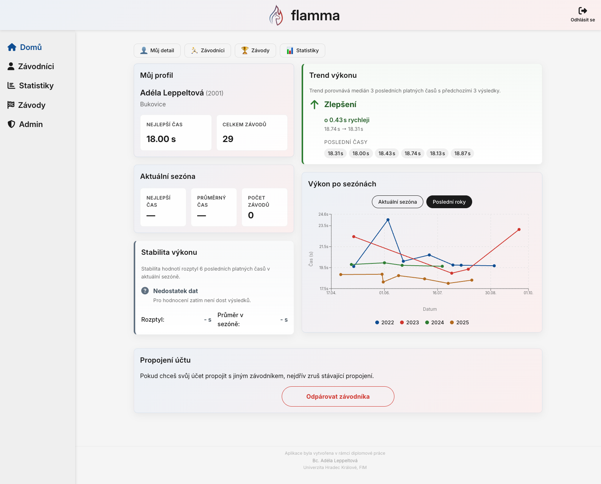
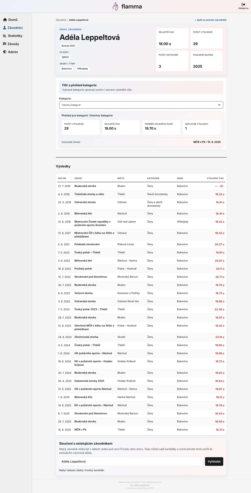
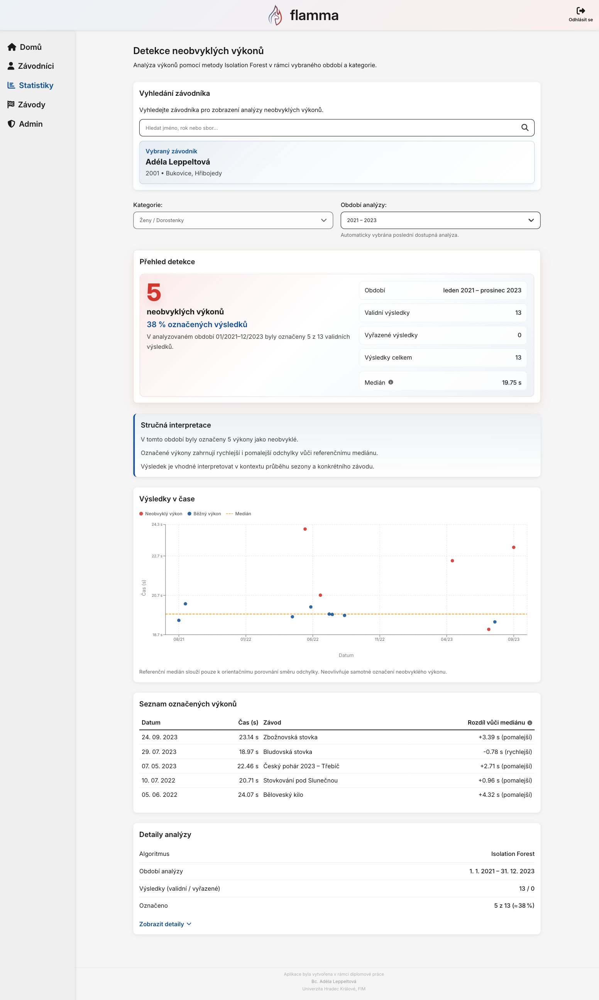
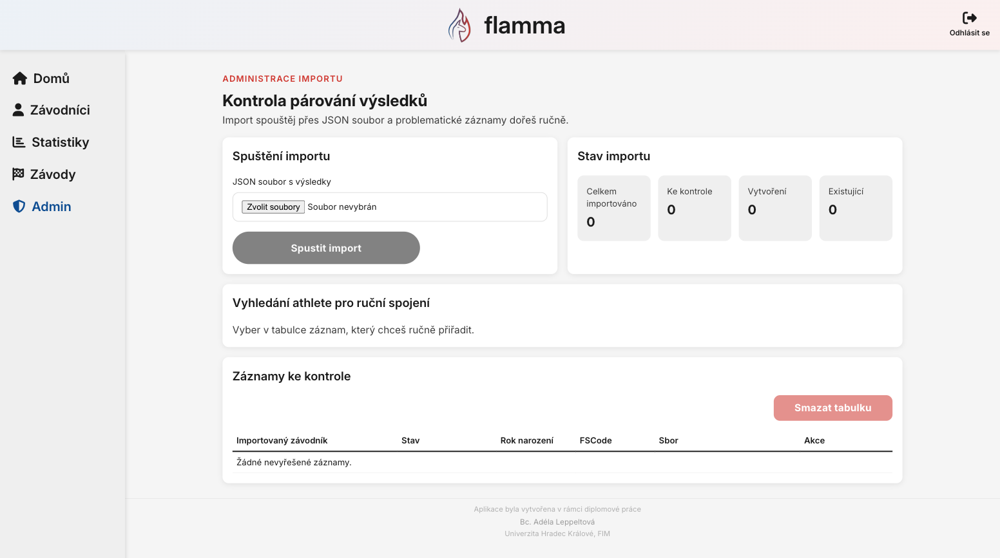
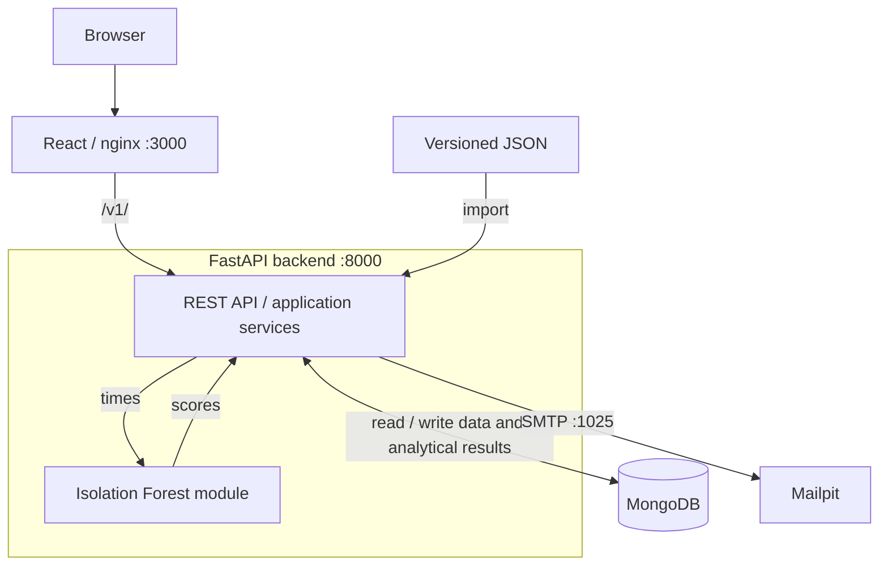

**EN** · [CZ](README.cs.md)

# Flamma

An analytical application for historical fire sport results, athlete identity resolution and machine learning-based anomaly detection.

[](https://github.com/adelaleppeltova/firesport-app/actions/workflows/ci.yml)

## Overview

Historical fire sport results are scattered across competition sheets with inconsistent names and incomplete athlete identifiers. Flamma brings these records into a searchable history of the **100 m obstacle race**, combining data processing, athlete identity resolution, a REST API, MongoDB storage, interactive visualization and machine learning.

I built Flamma as the practical part of my Master's thesis. I designed the data model and implemented the application and analysis workflow, connecting source JSON records to athlete histories and stored anomaly scores.



## Key Features & Screenshots

- Searchable, sortable, paginated athlete and competition lists, category result tables and athlete histories.
- Registration, login, password reset and account-to-athlete pairing; personal season, trend and stability summaries.
- JSON import, uncertain-match review, manual assignment and duplicate-athlete merging.
- Anomaly exploration by athlete, category group and overlapping three-year period.

<details>
<summary>Athlete history</summary>



</details>

<details open>
<summary>Unusual performances</summary>



</details>

<details>
<summary>Import administration</summary>



</details>

[Full screenshot gallery, including mobile layouts](docs/screenshots/README.md). The application interface is in Czech.

## Engineering Highlights

| Problem | Implemented approach and evidence |
| --- | --- |
| Incomplete, inconsistent identities | [Matching service](backend/app/services/result_matching.py) combines normalized names, birth year, team and FS code; ambiguous candidates remain available for review. A unique name and birth year can match despite a team change. |
| Preserving identity and handling duplicates | [Importer](backend/app/services/data_import.py) checks for duplicate results and retains `imported_athlete`, `match_status` and `match_reason` beside the canonical athlete reference. [Merge service](backend/app/services/athlete_merge.py) consolidates identities and associated references. |
| Different meanings of “unusual” | [Deterministic quality rules](backend/app/services/quality_flag_service.py) flag plausibility issues independently of [Isolation Forest](backend/app/ml/isolation_forest.py). The API exposes both signals. |
| Inspectable analytical outputs | [Window service](backend/app/services/anomaly_service.py) persists run parameters, skip reasons and per-result scores, and supersedes earlier runs on recomputation. |
| Consistent browser/API integration | [nginx](frontend/nginx.conf) serves the React build and proxies `/v1/` to FastAPI; typed response models and database indexes support application queries. |

## Technology Stack & Architecture

| Layer | Technologies |
| --- | --- |
| Frontend | React 18, React Router, TanStack Query, Axios, Recharts, Sass |
| Backend | Python 3.12, FastAPI, Pydantic, Motor/PyMongo, Argon2, JWT |
| Analysis | NumPy, scikit-learn Isolation Forest; pandas, Matplotlib and seaborn in EDA |
| Local runtime | Docker Compose, MongoDB, nginx, Mailpit |



[Architecture and API map](docs/architecture.en.md) · [Czech architecture](docs/architecture.md).

## Data Processing & Identity Resolution

The repository contains **329 JSON files, 394 category blocks and 13,854 source result rows**, with competition dates from **2019-05-04 to 2025-10-04** (recounted 2026-10-22). These are source counts, not guaranteed MongoDB counts: import normalizes values, reuses competitions and categories, and skips results considered duplicates.

Source filenames and generation timestamps are retained in JSON, but the original result sheets, retrieval URLs and extraction pipeline are absent. Matching is heuristic, and incomplete birth years and FS codes leave unresolved identities. See [data structure, collections, provenance and responsible use](docs/data-baseline.en.md) / [CZ](docs/data-baseline.md).

## Machine Learning Approach

A separate one-dimensional Isolation Forest is fitted to each **athlete × category group × three-year window**, using valid, non-null `final_time` values. At least 10 eligible results are required; groups with standard deviation below 0.01 s are skipped. The baseline uses 200 trees, `contamination="auto"` and seed 42.

The stored score is `-decision_function(X)`; anomaly labels come directly from `predict(X) == -1`. Direction describes an anomalous time relative to the group's median (`fast` or `slow`). A deterministic `quality_flag` is a separate signal and does **not** exclude a valid time from ML input.

This is a retrospective baseline, not a context-aware hierarchical performance model. No labelled ground truth is available to evaluate anomaly detection accuracy. The model does not account for weather, track characteristics or competition-specific conditions. Interpretation depends on data quality, completeness and correct athlete matching. [Full methodology and limitations](docs/ml-baseline.en.md) / [CZ](docs/ml-baseline.md).

## Getting Started & Reproducibility

Use Git, Docker Engine/Desktop with Compose, and Python 3 to generate a secret. Run from a new clone:

```bash
git clone https://github.com/adelaleppeltova/firesport-app.git
cd firesport-app
cp backend/.env.example backend/.env
python3 - <<'PYSECRET'
from pathlib import Path
import secrets
p = Path("backend/.env")
p.write_text(p.read_text().replace("replace-with-a-random-secret", secrets.token_urlsafe(64)))
PYSECRET
docker compose up --build -d
```

The backend loads `backend/.env` through python-dotenv; container environment values take precedence. Never commit `.env`.

Open [the app](http://localhost:3000), [Swagger](http://localhost:8000/docs), [OpenAPI JSON](http://localhost:8000/openapi.json) or [Mailpit](http://localhost:8025). Compose starts the services and creates database indexes, but **does not import historical results** (`IMPORT_DATA=false`).

Follow the [reproducibility guide](docs/reproducibility.md) / [CZ](docs/reproducibility.cs.md) to populate the database and generate analytical outputs. **The seed script deletes six MongoDB collections before importing data while preserving user accounts. Run it only against an isolated, disposable database.** The Compose setup is for local development, with debug mode, reload and exposed database ports.

## Testing & Documentation

[GitHub Actions](.github/workflows/ci.yml) runs backend linting and tests, frontend linting and tests, and the frontend production build.

| English | Česky |
| --- | --- |
| [Architecture and API](docs/architecture.en.md) | [Architektura a API](docs/architecture.md) |
| [Data baseline](docs/data-baseline.en.md) | [Datový základ](docs/data-baseline.md) |
| [ML baseline](docs/ml-baseline.en.md) | [ML baseline](docs/ml-baseline.md) |
| [Reproducibility](docs/reproducibility.md) | [Reprodukovatelnost](docs/reproducibility.cs.md) |
| [EDA notebook guide](docs/notebooks/README.md) | [Průvodce EDA notebookem](docs/notebooks/README.cs.md) |

## Author & Academic Background

**[Adéla Leppeltová](https://github.com/adelaleppeltova)** · Data Science

Flamma was developed as the practical component of my Master's thesis, *Analýza sportovních dat metodami strojového učení* (Analysis of sports data using machine learning methods). It is an academic project and part of my technical portfolio.
