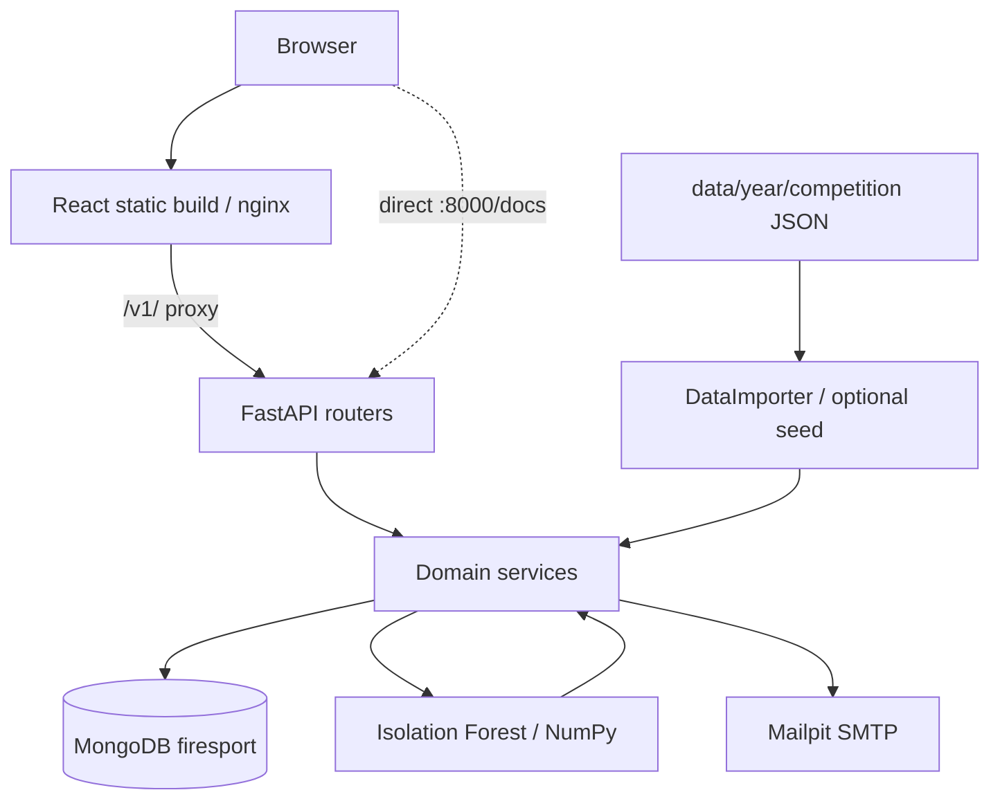

[EN](architecture.en.md) · [CZ](architecture.md) · [Project](../README.md)

# Application architecture

This describes the implemented repository baseline, not a production deployment design.

## Runtime and boundaries

[Compose](../docker-compose.yml) starts `frontend`, `backend`, `mongo` and `mailpit`. The frontend Dockerfile builds with Node 20 (`npm ci`, `npm run build`), then copies static assets into nginx; Node is absent from the runtime image. [nginx](../frontend/nginx.conf) has an SPA fallback to `index.html` and proxies `/v1/` to `backend:8000`. Compose supplies an empty `REACT_APP_API_URL`, so browser calls use the same origin.

The [backend entrypoint](../backend/entrypoint.sh) waits for MongoDB, optionally seeds only with `IMPORT_DATA=true`, and starts uvicorn with reload. `DEBUG=true` also enables debugpy on port 5679. The backend directory is mounted at `/app`, the repository data at `/app/data:ro`, and MongoDB persists in `mongo-data`.

[Package initialization](../backend/app/__init__.py) calls `load_dotenv()` before application submodules load. In this layout it discovers `/app/.env` (host `backend/.env`); python-dotenv does not override existing process environment values. Compose's `MONGO_URL=mongodb://mongo:27017` therefore takes precedence over the example's localhost value. Authentication checks `SECRET_KEY` at module import and rejects empty/placeholder values. No explicit Compose `env_file` is currently configured.

## Backend organization

| Directory | Responsibility |
| --- | --- |
| [`api/v1`](../backend/app/api/v1) | HTTP parsing, dependencies and response models |
| [`models`](../backend/app/models) | Pydantic schemas for API data; these do not impose MongoDB validators |
| [`services`](../backend/app/services) | Authentication, import, matching, merging, search, summaries and analysis orchestration |
| [`db`](../backend/app/db) | Motor connection and startup indexes; database name is explicitly `firesport` |
| [`ml`](../backend/app/ml) | Immutable anomaly configuration, category grouping and numerical model |
| [`tests`](../backend/app/tests) | Unit/service tests including matching, quality rules and ML semantics |

Most data services use asynchronous Motor. Authentication dependencies and some account operations use synchronous PyMongo. References are maintained by application code; there are no enforced foreign keys. Startup [indexes](../backend/app/db/database.py) include unique user email, unique run ID and unique `(run_id, result_id)` scores; result identity lookup indexes are non-unique.

## API map and access

All routers below are mounted with `/v1` in [`main.py`](../backend/main.py). Inspect [Swagger](http://localhost:8000/docs) or [OpenAPI JSON](http://localhost:8000/openapi.json) after startup for complete request and response schemas.

| Prefix / route | Purpose | Access in current code |
| --- | --- | --- |
| `/v1/auth` | Register, login, refresh, logout and password reset | Mixed public operations and authenticated `/me` |
| `/v1/me` | Current user and athlete pairing | Bearer token |
| `/v1/athletes`, `/v1/competitions`, `/v1/results` | Public lists, details and summaries | No router-wide auth dependency |
| `/v1/admin` | Import, review, assignment and athlete merging | `require_admin` dependency |
| `POST /v1/data/import`, `POST /v1/data/import/raw` | File/body JSON import | No auth dependency |
| `GET /v1/ml/windows` | Stored detection windows, optional athlete filter | No auth dependency |
| `POST /v1/ml/recompute-yearly` | Mutating batch recomputation | No auth dependency |
| `GET /v1/athletes/{athlete_id}/anomalies` | Stored scores and run metadata | No auth dependency |

The import and recomputation routes are not protected by the admin router's dependency. UI visibility is not an API permission boundary. This is a deployment limitation requiring an engineering decision.

## Authentication

[Authentication service](../backend/app/services/auth.py) signs HS256 JWTs with `SECRET_KEY`. Access tokens identify a user through bearer authorization. Refresh tokens have a `jti` recorded in the user document and are transported in an HTTP-only cookie. Password reset uses an expiring token and email; Mailpit captures local SMTP.

The [browser helper](../frontend/src/utils/passwordHash.js) hashes entered passwords with SHA-256 using Web Crypto; backend Argon2 hashes the supplied value. Direct API clients must follow the expected password representation in the [auth models](../backend/app/models/auth.py). Client hashing is not a replacement for HTTPS. Registration creates a `user` role; there is no documented first-admin bootstrap tool. Review admin provisioning before relying on UI-based identity cleanup.

## Frontend organization

[`frontend/src`](../frontend/src) separates pages, reusable components, public/authenticated layouts, API helpers, hooks, authentication context, SCSS and utilities. TanStack Query handles server-state queries; Recharts renders performance and anomaly charts. The statistics page reads persisted runs/scores, rather than fitting a model in the browser. Account pairing enables the personal dashboard.

## Operational limits and tests

The Compose setup exposes MongoDB, SMTP, the backend and debugger to the host; uses mutable image tags; and enables reload. CORS includes localhost and a hard-coded development tunnel origin, not a verified deployment. TLS, production secret management, route protection and operational backups need separate work.

[CI](../.github/workflows/ci.yml) runs Ruff/pytest on Python 3.12 and frontend lint, tests and build on the Node version in [`.nvmrc`](../frontend/.nvmrc). Push triggers are limited to `main` and `m0/**`; PRs target `main`. Unit tests do not constitute an end-to-end Docker/import test. See [reproducibility](reproducibility.md), [data flow](data-baseline.en.md) and [ML methodology](ml-baseline.en.md).
