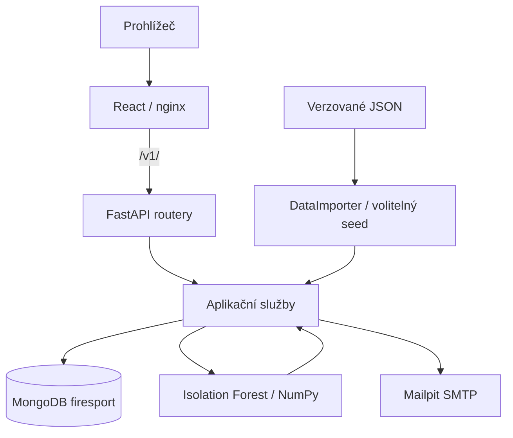

[EN](architecture.en.md) · **CZ** · [Projekt](../README.cs.md)

# Architektura aplikace

Tento dokument popisuje současnou M0 baseline projektu firesport-app.

## Přehled

```text
React frontend
    ↓ HTTP / REST
nginx
    ↓ /v1/
FastAPI backend
    ↓
MongoDB
```

React aplikace používá REST API backendu pro autentizaci, práci se závodníky, soutěžemi, výsledky, importem a analytickými výstupy. Backend vedle aplikačních služeb obsahuje ML část pro detekci neobvyklých výkonů pomocí Isolation Forest.

## Backend

Backend je aplikace ve FastAPI. Hlavní adresáře v `backend/app` jsou:

- `api` – HTTP routery a endpointy API pod prefixem `/v1`,
- `models` – datové a validační modely používané API a službami,
- `services` – aplikační logika pro autentizaci, závodníky, soutěže, výsledky, import a analytické výstupy,
- `db` – připojení k MongoDB a databázová inicializace,
- `ml` – konfigurace a výpočet detekce anomálií pomocí Isolation Forest,
- `tests` – backendové testy spouštěné pomocí pytest.

## Frontend

Frontend je jednostránková React aplikace s routováním přes React Router. Hlavní části v `frontend/src` jsou:

- `pages` – jednotlivé obrazovky aplikace,
- `components` – sdílené i doménové UI komponenty,
- `layouts` – rozložení veřejné a přihlášené části aplikace,
- `api` – Axios klient a API helpery,
- `hooks` – vlastní React hooky pro načítání dat a stav,
- `context` – sdílený kontext, zejména autentizace,
- `assets` – styly a obrazové prostředky,
- `utils` – pomocné frontendové funkce.

## Běhové prostředí a Docker

Docker image frontendu používá multi-stage build. V první stage s Node.js 20 se pomocí `npm ci` nainstalují závislosti a `npm run build` vytvoří produkční statické soubory. Runtime stage používá nginx a Node.js ani npm už neobsahuje.

Nginx servíruje React build na portu 80 kontejneru, který Docker Compose mapuje na `http://localhost:3000`. Pro React Router používá SPA fallback na `index.html`. Požadavky na `/v1/` proxyuje na službu `backend` na portu 8000, takže frontend používá relativní API URL.

FastAPI backend je dostupný také přímo na `http://localhost:8000`, poskytuje REST API a komunikuje s MongoDB přes interní Docker síť. Swagger dokumentace je dostupná na `http://localhost:8000/docs`.

## Testování a CI

- Backendové unit a service testy se spouštějí příkazem `python -m pytest app/tests` s Pythonem 3.12; aktuální počet určuje pytest.
- Frontend má současný základní test spouštěný neinteraktivně příkazem `CI=true npm test -- --watchAll=false` s Node.js 20.
- Produkční frontend build se ověřuje příkazem `npm run build`.
- [GitHub Actions](../.github/workflows/ci.yml) spouští backendový Ruff/pytest a frontendový lint, testy a build při pushi do `main` nebo `m0/**`, PR do `main` a ručně. Unit testy nejsou integračním testem Dockeru a importu.

## Tok služeb



## Konfigurace a autentizace

[Inicializace balíčku](../backend/app/__init__.py) volá `load_dotenv()`. V Dockeru objeví `/app/.env`, tedy hostitelský `backend/.env` připojený s backendem. Hodnoty již nastavené v prostředí mají přednost: zejména Compose `MONGO_URL=mongodb://mongo:27017` nahrazuje localhost z příkladu. Compose nemá explicitní `env_file`. [Autentizační služba](../backend/app/services/auth.py) při importu odmítá prázdný či zástupný `SECRET_KEY`.

Přístupový JWT používá HS256 a hlavičku Bearer; refresh token má evidované `jti` a přenáší se HTTP-only cookie. Obnova hesla používá expirovatelný token a lokální SMTP Mailpit. [Frontend](../frontend/src/utils/passwordHash.js) před odesláním hashuje heslo pomocí SHA-256, backend hashuje přijatou hodnotu Argon2. Přímý API klient musí respektovat [modely autentizace](../backend/app/models/auth.py); hashování nenahrazuje HTTPS. Registrace vytváří roli `user`; dokumentovaný nástroj pro vytvoření prvního administrátora chybí.

## API a oprávnění

Prefix `/v1` připojuje [main.py](../backend/main.py). Úplné schéma je v [Swaggeru](http://localhost:8000/docs) a [OpenAPI JSON](http://localhost:8000/openapi.json).

| Cesta | Účel a současný přístup |
| --- | --- |
| `/v1/auth` | Registrace, přihlášení, refresh, logout, obnova hesla; smíšené veřejné a chráněné operace |
| `/v1/me` | Profil a párování závodníka; Bearer token |
| `/v1/athletes`, `/v1/competitions`, `/v1/results` | Seznamy, detaily a souhrny bez společné autentizační závislosti |
| `/v1/admin` | Import, kontrola a slučování; `require_admin` |
| `POST /v1/data/import`, `POST /v1/data/import/raw` | Import bez autentizační závislosti |
| `GET /v1/ml/windows` | Uložená analytická okna bez autentizační závislosti |
| `POST /v1/ml/recompute-yearly` | Zápisový přepočet bez autentizační závislosti |
| `GET /v1/athletes/{athlete_id}/anomalies` | Čtení skóre bez autentizační závislosti |

Omezení administračního UI nechrání importní ani ML API. Před veřejným nasazením je nutné rozhodnout o jejich oprávnění.

## Databázové a provozní hranice

Většina datových služeb používá asynchronní Motor, část účtů a autentizační závislosti synchronní PyMongo. [Inicializace indexů](../backend/app/db/database.py) vynucuje unikátní e-mail, `run_id` a dvojici `(run_id, result_id)` u skóre; indexy pro hledání identity výsledků unikátní nejsou. Vazby spravuje aplikace, databáze nevynucuje cizí klíče ani Pydantic schémata.

Compose připojuje `data/` pouze pro čtení, MongoDB zachovává v `mongo-data`. Zapíná debugpy na portu 5679, uvicorn reload a hostitelské porty pro databázi i SMTP. Obrazy nejsou uzamčeny digestem. CORS zahrnuje localhost a pevně zadaný vývojový tunel; nejde o doloženou produkční adresu. TLS, produkční tajemství, oprávnění a zálohy vyžadují samostatnou práci.

Viz [reprodukovatelnost](reproducibility.cs.md), [datový tok](data-baseline.md) a [metodika ML](ml-baseline.md).
