**EN** · [CZ](data-baseline.md) · [Project](../README.md)

# Data baseline

This documents versioned inputs and implemented import rules. Source counts below were recomputed from the checkout on **2026-10-22**; they describe JSON rows, not a guaranteed fresh-import database state.

## Coverage and provenance

[`data/`](../data) contains **329 JSON files**, **394 category blocks** and **13,854 result rows**, covering competition dates **2019-05-04–2025-10-04**, mainly the 100 m obstacle race. Multiple files can represent different categories of one competition; file count is not competition count.

Every JSON contains `source_file` and `generated_at`; many include `warnings` or `parsing_notes`. These identify source filenames and derived-file creation times, not verified retrieval dates. Original result sheets, source URLs and the extraction workflow are not versioned. External provenance and completeness cannot be reconstructed from the repository alone. The input is a selected historical sample, not a census of every competition or athlete.

| Verified source-level gap | Rows / blocks |
| --- | ---: |
| Missing or zero birth year | 6,233 result rows |
| Missing FS code | 6,155 result rows |
| `final_status` other than `valid` | 504 result rows |
| Missing explicit discipline | 26 category blocks |

## JSON structure and normalization

Each file is an object with source metadata and `competition`: name, place, `YYYY-MM-DD` date, league and `categories`. Each category contains a name, optional discipline and results. A result contains names, birth year, `fscode`, team, district, start number, rank, attempts (`try`, `time`, `status`), `final_time` and `final_status`. A real example is [`data/2019/beloves/komplet.json`](../data/2019/beloves/komplet.json).

The [importer](../backend/app/services/data_import.py) converts dates to datetimes, league to a list, category/team/person names to normalized casing, strips `SDH` from teams, trims FS codes and treats birth year `0` as missing. Attempt key `try` becomes `attempt`; `final_status` becomes `final_time_status`. The imported identity is kept separately from the canonical athlete reference.

`source_file`, `generated_at`, `warnings`, `parsing_notes` and `district` are **not carried into the main MongoDB records**. Retain the JSON alongside the database for provenance. Pydantic [result models](../backend/app/models/result.py) describe API data, but the importer inserts dictionaries directly: there is no complete schema-validation pass or database validator guaranteeing all stored values conform. Errors may be collected per result while earlier writes remain committed; an HTTP success or seed exit code alone is not proof of complete import.

```mermaid
flowchart LR
    Sheets[Original result sheets - absent] -.-> JSON[Versioned JSON with source metadata]
    JSON --> Normalize[Normalize fields]
    Normalize --> Match[Match active athlete identity]
    Match --> Review[Uncertain identity review]
    Match --> Dedupe[Application duplicate lookup]
    Dedupe --> Flags[Import-time deterministic quality flag]
    Flags --> Mongo[(Results and related collections)]
    Review -->|manual assignment / merge| Mongo
    Mongo --> Windows[Eligible athlete / category / window groups]
    Windows --> IF[Isolation Forest]
    IF --> Scores[(Runs and scores)]
    Scores --> API[API and React charts]
```

## Import paths and destructive seed

- `POST /v1/data/import`: multipart JSON file, currently without auth dependency.
- `POST /v1/data/import/raw`: JSON request body, currently without auth dependency.
- `POST /v1/admin/import`: administrator import route, protected by `require_admin`.
- [`scripts/load_data.py`](../backend/scripts/load_data.py): sorted recursive `/app/data/**/*.json` import, optionally called by the entrypoint when `IMPORT_DATA=true` (Compose defaults to `false`).

**The seed deletes all documents in `results`, `competitions`, `athletes`, `categories`, `anomaly_runs` and `anomaly_scores` before checking the data directory. It leaves `users` intact.** Existing account pairing references can therefore become stale. Its paths and MongoDB readiness URI assume the Docker network; use only an isolated disposable dataset. Ordinary file/body imports do not perform this collection wipe, but still write to the database. Follow [reproducibility](reproducibility.md).

## Athlete matching and duplicates

[Matching](../backend/app/services/result_matching.py) searches active athletes using normalized names, then birth year, team and FS code:

- A unique name/birth-year match is accepted; with several such candidates, an FS code can disambiguate.
- Without a birth year, one name/team match can be accepted; name-only and multiple candidates require review.
- A known birth year can match a name/team athlete with a missing year and enrich that identity. Conflicting known birth years can lead to creating a separate athlete.
- Missing names or no match yield `unmatched`. The importer creates a new athlete when both names are present, marking the result matched; otherwise the result can remain without an athlete reference.

The match reason and original identity remain on the result. Existing identities can gain missing birth year, FS codes or teams. Candidate lookup is limited to ten per query; matching is a heuristic, not a globally unique identifier guarantee. Admin services support manual assignment, new identity creation and merging. These decisions change subsequent analysis eligibility.

Competitions are reused by exact `(name, place, date)` and categories primarily by name, including case-insensitive lookup. Result duplicate lookup uses competition, category, imported first/last name and start number, adding birth year/FS code when available. It is not a unique index or correction/upsert mechanism; changed metadata and concurrent imports can produce unexpected duplicate behaviour. Do not equate source row totals with stored counts.

## MongoDB collections

The database name is explicitly `firesport`. Relationships are maintained by application services, without enforced foreign keys.

| Collection | Purpose and principal relationships |
| --- | --- |
| `athletes` | Canonical names, optional birth year, `fs_codes`, teams, active/merge state; referenced from results, scores and optional account pairing |
| `competitions` | Name, place, date, league and timestamps; referenced by `results.competition` |
| `categories` | Name, optional discipline and timestamps; referenced by `results.category` |
| `results` | Optional `athlete`, competition/category, date, team, original identity, match state/reason, attempts, final time/status, rank and quality flag |
| `anomaly_runs` | Run ID, creation time, window, model metadata, status/counters and superseded state |
| `anomaly_scores` | Run/athlete/result references, performance date/time, score, median, label, direction and category group |
| `users` | Email, password hash, role, active state, refresh-token records, optional athlete pairing and temporary password-reset metadata |

Most relationships use MongoDB ObjectId; `users.athlete_id` is stored as a string. [Startup indexes](../backend/app/db/database.py) enforce unique user emails, run IDs and run/result score pairs, but not unique results.

## Quality controls and analytical meaning

The deterministic [quality service](../backend/app/services/quality_flag_service.py) uses exact-category 1st/99th percentiles clamped to 11–45 s and a greater-than-25% slowdown against five earlier times for the same athlete/category. Invalid/missing times receive `ok`; it does not certify validity. Unpaired import rows and flag calculation errors also fall back to `ok`.

Flags computed during import depend on which records already exist and cached percentile bounds. A full recomputation over completed data may differ. The [ML baseline](ml-baseline.en.md) groups categories and windows differently and does not filter out `suspicious` times. The [EDA guide](notebooks/README.md) explains its separate source-level flags.

Unresolved matches, missing fields, discarded source metadata, heuristic deduplication and partial import errors remain material ambiguities. In particular, valid results without `athlete` can break ML grouping and must be inspected before recomputation.

## Historical database snapshot

The previous Czech documentation recorded a read-only local-volume inspection dated **2026-08-12**: 4,350 athletes, 65 competitions, 13 categories, 13,785 results, 21 anomaly runs (7 active, 14 superseded), 5,477 scores and 9 users. These values are retained as historical documentation, **not reverified here**. The volume and its mutation history are not versioned; none of these counts is an acceptance target for fresh import.

## Privacy, licensing and responsible use

Names, birth years, clubs, FS codes and linked accounts can identify people, including young athletes. Public source results do not by themselves establish permission for every redistribution or derived use. No dataset redistribution license or source permission register was found. The repository owner needs to clarify source rights, intended publication, retention/correction requests and screenshot consent. Keep account records and secrets out of analysis exports. Treat flags as review prompts, not personal judgements or allegations.

For an informal software reference and licensing status, see the [project README](../README.md). A source manifest with URLs, retrieval dates, checksums, extraction versions and usage permissions is proposed future work, not currently implemented.
