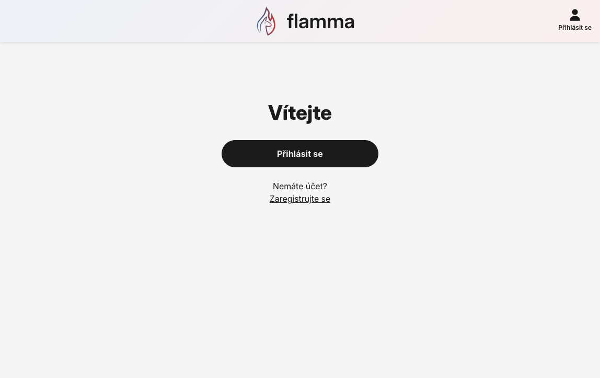
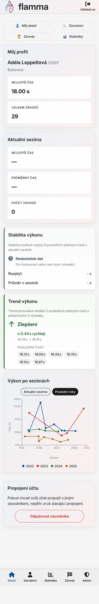
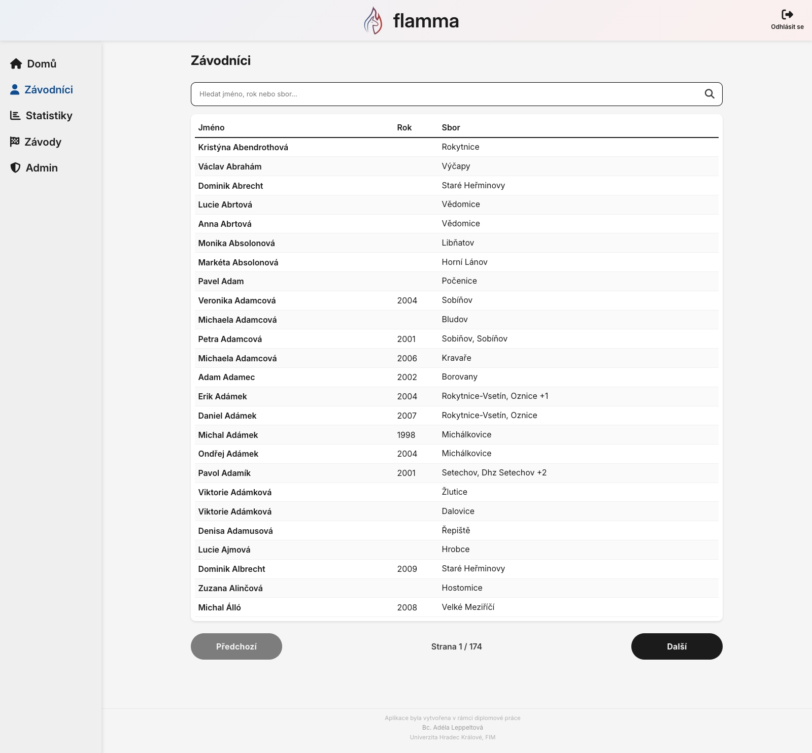
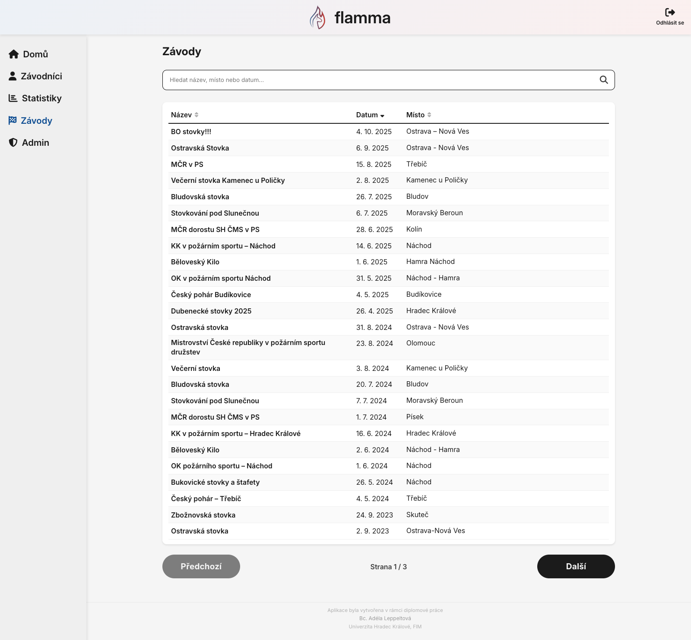
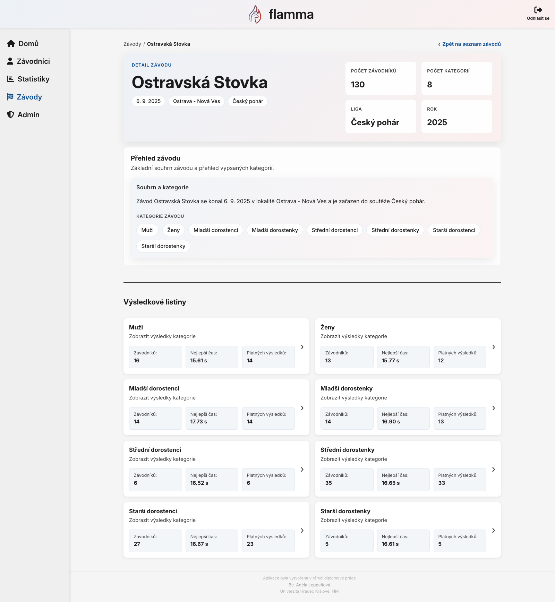
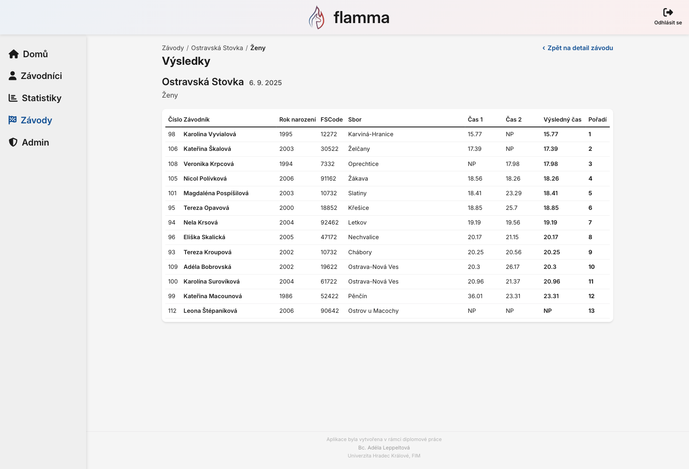
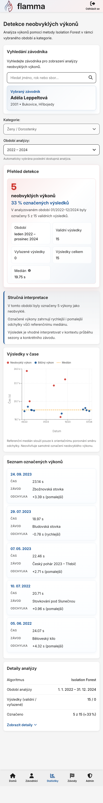
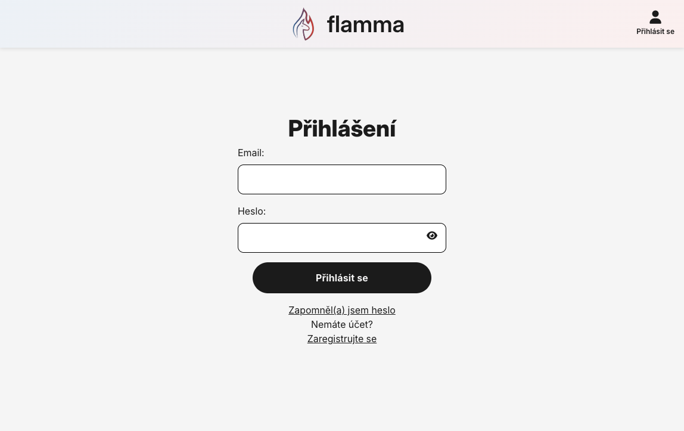
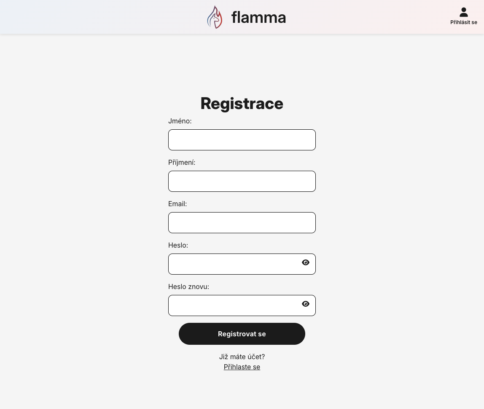
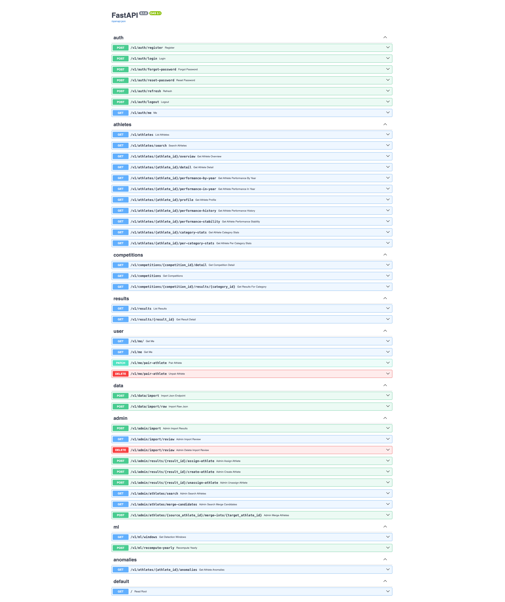

[EN project](../../README.md) · [CZ projekt](../../README.cs.md)

# Screenshot gallery / Galerie aplikace

Existing screenshots illustrate the Czech interface and historical local data. Counts, dates and anomaly percentages in images are not fresh-import expectations or model validation. Source dates of captures are not recorded. The repository owner should review publication of identifiable athlete information.

Existující screenshoty ukazují české rozhraní a historická lokální data. Počty, data a podíly anomálií nejsou očekáváním čerstvého importu ani validací modelu. Datum pořízení není zaznamenáno. Vlastník by měl posoudit zveřejnění identifikovatelných údajů závodníků.

## Welcome screen / Uvítací obrazovka

## Personal dashboard / Osobní přehled

## Personal dashboard on mobile / Osobní přehled na mobilu

## Athlete list / Seznam závodníků

## Athlete detail and result history / Detail závodníka a historie výsledků

## Competition list / Seznam soutěží

## Competition detail / Detail soutěže

## Category result table / Výsledková listina kategorie

## Anomaly analysis / Analýza neobvyklých výkonů

## Anomaly analysis on mobile / Analýza na mobilu

## Import and identity review / Import a kontrola identit

## Login / Přihlášení

## Registration / Registrace

## Swagger API documentation / Swagger dokumentace API

